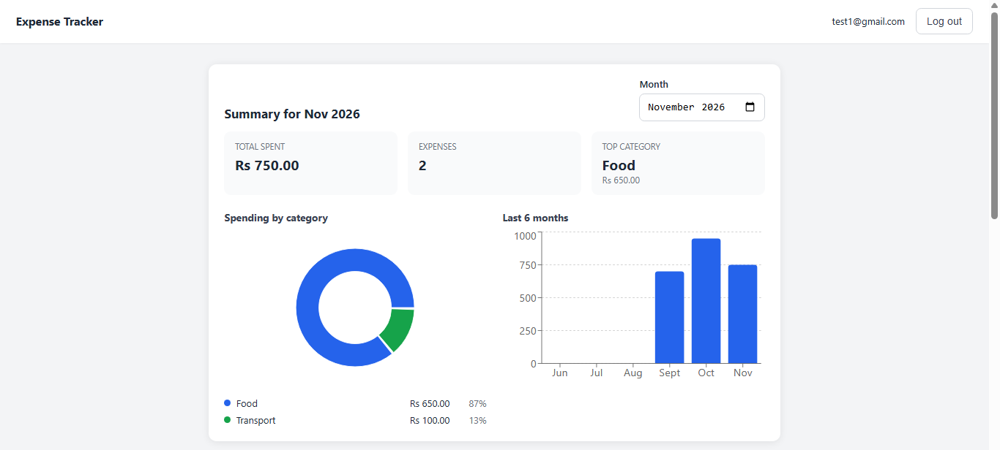
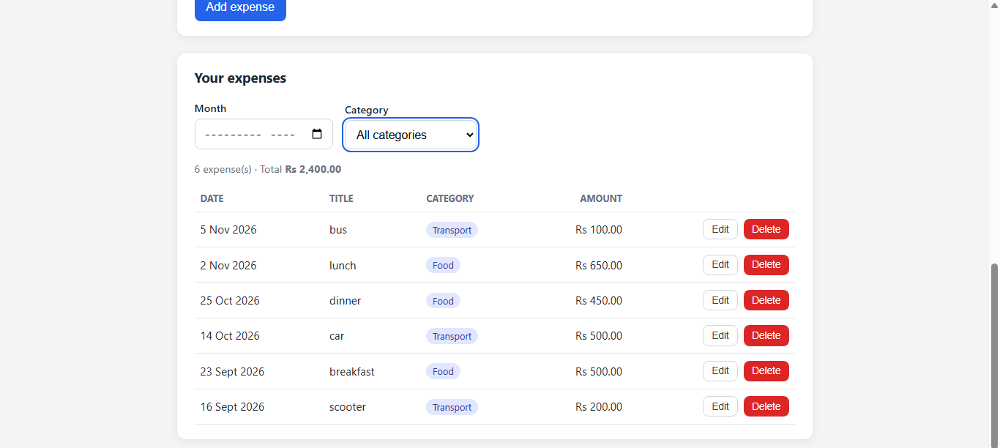
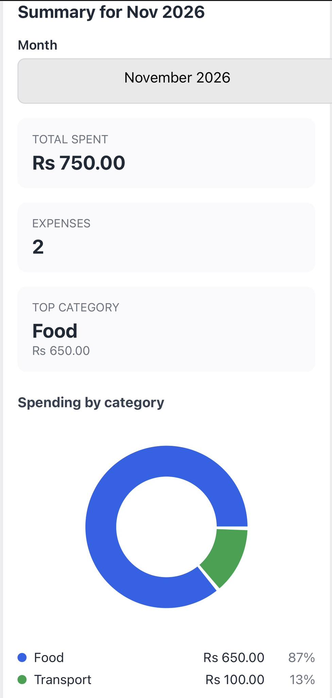
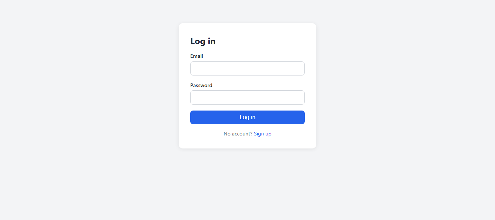
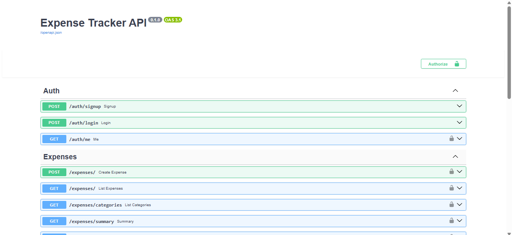

# Expense Tracker

A full-stack personal expense tracker. Users sign up, log in, record expenses by category, and see monthly totals and charts on a dashboard. Each user can only see their own data.

**Live demo:** https://expense-tracker-pi-dusky-24.vercel.app
**API docs:** https://expense-tracker-api-l9w8.onrender.com/docs

> The backend runs on a free hosting plan that goes to sleep when idle, so the first request after a quiet period can take up to a minute. After that it responds normally. Sign up with any email to try it, and use a throwaway password.



## Features

- **Authentication:** sign up and log in with email and password. Passwords are hashed with bcrypt, and sessions use signed JWT tokens that expire after 60 minutes.
- **Private data:** every expense belongs to one user, and every query is filtered by the logged-in user. Another user's expense returns a 404.
- **Expense management:** add, edit, and delete expenses, with validation on both the frontend and the backend.
- **Filters:** filter the list by month and by category. Categories are normalized, so `food` and `FOOD` count as one.
- **Monthly summary:** total spent, number of expenses, and the top category for any month.
- **Charts:** spending by category (donut chart) and the last six months (bar chart).
- **Responsive layout:** works on phones, where the table turns into cards.
- **Tested API:** 9 automated pytest tests covering authentication, data isolation, validation, filters, and the summary.

## Screenshots

| Expenses and filters                  | Mobile view                       |
|---------------------------------------|-----------------------------------|
|  |  |

| Login                           | API documentation                     |
|---------------------------------|---------------------------------------|
|  |  |

## Tech Stack

| Layer   | Technology                                                    |
|---------|---------------------------------------------------------------|
| Frontend| React (Vite), React Router, Recharts                          |
| Backend | Python, FastAPI, SQLAlchemy, Pydantic                         |
| Auth    | JWT (PyJWT), bcrypt                                           |
| Database| PostgreSQL (Neon) in production, SQLite for local development |
| Testing | pytest, FastAPI TestClient                                    |
| Hosting | Vercel (frontend), Render (backend), Neon (database)          |

## API Overview

| Method| Endpoint              | Description |
|-------|-----------------------|---------------------------------------------------------------|
| POST  | `/auth/signup`        | Create an account                                             |
| POST  | `/auth/login`         | Log in and receive a token                                    |
| GET   | `/auth/me`            | Get the current user                                          |
| GET   | `/expenses/`          | List expenses (filters: `month`, `category`, `skip`, `limit`) |
| POST  | `/expenses/`          | Add an expense                                                |
| GET   | `/expenses/categories`| List the user's categories                                    |
| GET   | `/expenses/summary`   | Monthly total and totals per category                         |
| GET   | `/expenses/{id}`      | Get one expense                                               |
| PATCH | `/expenses/{id}`      | Update an expense                                             |
| DELETE| `/expenses/{id}`      | Delete an expense                                             |

Full interactive documentation is available at `/docs` on the backend.

## Run Locally

**Requirements:** Python 3.12 or newer, and Node.js 18 or newer.

### 1. Clone the repository

git clone https://github.com/samridhiidahal/expense-tracker.git
cd expense-tracker

### 2. Start the backend

cd backend
python -m venv .venv
.\.venv\Scripts\Activate.ps1
pip install -r requirements.txt
uvicorn app.main:app --reload

On macOS or Linux, activate with `source .venv/bin/activate` instead.

The API runs at http://localhost:8000. A local SQLite database file is created automatically. To change any settings, copy `.env.example` to `.env` and edit it.

### 3. Start the frontend

In a second terminal:

cd frontend
npm install
npm run dev

Open http://localhost:5173.

### 4. Run the tests

cd backend
python -m pytest -v


The tests use a temporary in-memory database, so they never touch real data.


## Project Structure

```
expense-tracker/
├── backend/
│   ├── app/
│   │   ├── main.py          # app setup, CORS, routers
│   │   ├── database.py      # database connection
│   │   ├── models.py        # SQLAlchemy tables
│   │   ├── schemas.py       # request and response validation
│   │   ├── auth.py          # password hashing and JWT helpers
│   │   └── routes/          # auth and expense endpoints
│   ├── tests/               # pytest tests
│   └── requirements.txt
├── frontend/
│   ├── src/
│   │   ├── pages/           # login, signup, dashboard
│   │   ├── components/      # expense form, summary charts
│   │   ├── api.js           # API client that attaches the token
│   │   └── AuthContext.jsx  # login state
│   └── vercel.json
└── screenshots/
```

## Deployment

- **Database:** a free PostgreSQL database on Neon.
- **Backend:** a web service on Render, with the root directory set to `backend`, and `DATABASE_URL`, `SECRET_KEY` and `FRONTEND_URL` set as environment variables.
- **Frontend:** a Vite project on Vercel, with the root directory set to `frontend` and `VITE_API_URL` pointing to the backend.

## What I Would Improve Next

- Add a single endpoint for the six-month trend. The chart currently makes one request per month.
- Use a migration tool such as Alembic instead of creating tables at startup.
- Add refresh tokens, so users are not logged out after an hour.
- Add rate limiting on the login endpoint.
- Add budgets per category, with a warning when a limit is passed.
- Add frontend tests.

## Author

Samridhi Dahal
B.E. Computer Engineering, Tribhuvan University
GitHub: [samridhiidahal](https://github.com/samridhiidahal)
